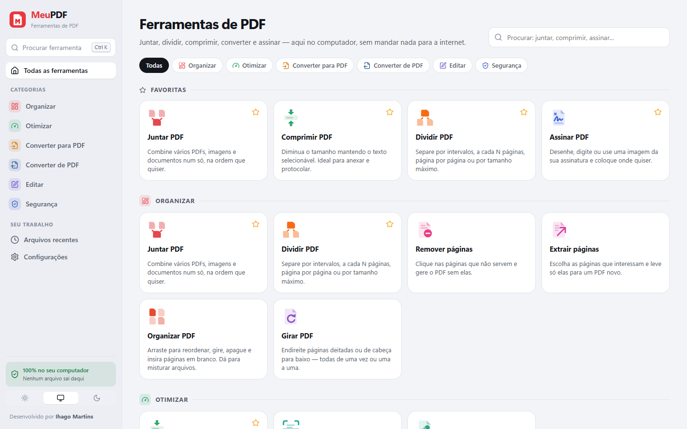
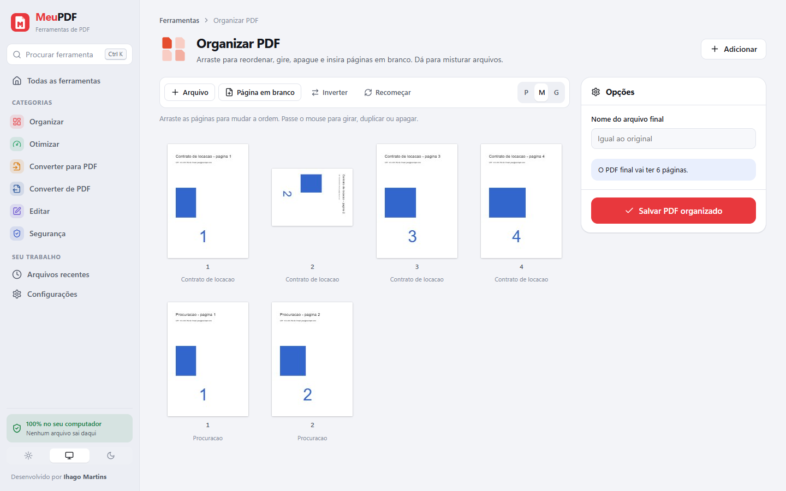
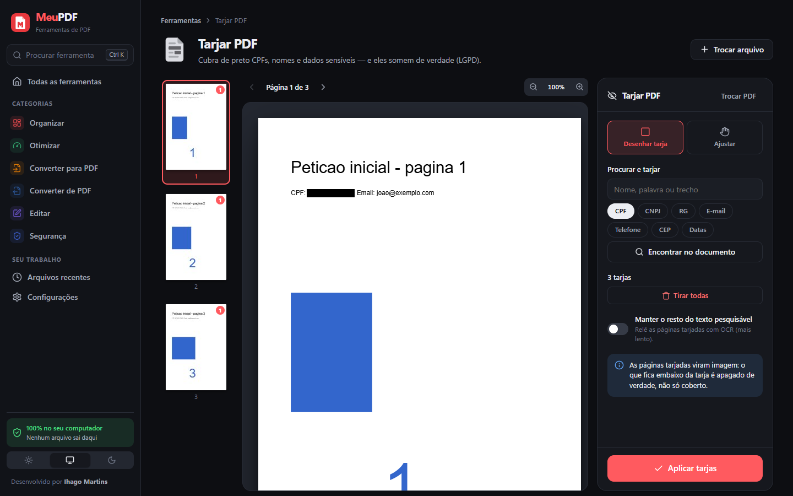
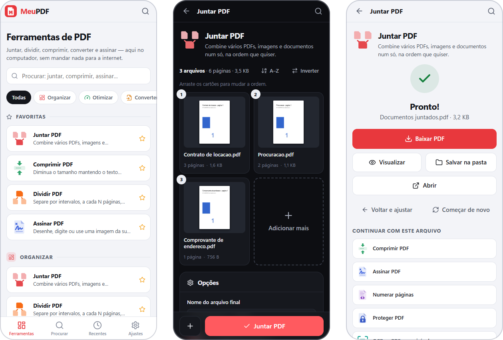

<div align="center">


# MeuPDF

**Todas as ferramentas de PDF num app para Windows — sem mandar nada para a internet.**

31 ferramentas — juntar, dividir, comprimir, converter, OCR, assinar, tarjar e
muito mais — rodando no seu computador. Funciona também no celular.

[**⬇ Baixar para Windows**](https://github.com/ihagoxd/MeuPDF/releases/latest)
&nbsp;·&nbsp; [Ferramentas](#ferramentas) &nbsp;·&nbsp; [Usar no celular](#usar-no-celular) &nbsp;·&nbsp; [Desenvolvimento](#desenvolvimento)

[](https://github.com/ihagoxd/MeuPDF/releases/latest)
[](https://github.com/ihagoxd/MeuPDF/actions/workflows/testes.yml)
[](LICENSE)


</div>

<picture>
  <source media="(prefers-color-scheme: dark)" srcset="docs/inicio-escuro.png">
  
</picture>

## Instalar

1. Baixe o instalador (`MeuPDF-Instalador-<versão>.exe`) na [página de versões](https://github.com/ihagoxd/MeuPDF/releases/latest).
2. Rode o instalador. Ele instala só para o seu usuário (não pede senha de
   administrador) e cria os atalhos na área de trabalho e no menu Iniciar.
3. Pronto: o MeuPDF abre numa janela própria. Para desinstalar, use
   "Adicionar ou remover programas".

> O instalador não tem assinatura digital paga, então na primeira vez o Windows
> pode mostrar "O Windows protegeu o computador". Clique em **Mais informações →
> Executar assim mesmo**.

O app instalado já traz tudo o que precisa, inclusive os dados do OCR. Algumas
conversões usam programas que talvez já estejam no computador:

| Programa | Para quê |
|---|---|
| Microsoft Office **ou** LibreOffice | Word, Excel e PowerPoint → PDF |
| Microsoft Edge ou Google Chrome | Site para PDF (o Edge já vem no Windows) |
| Ghostscript (opcional) | compressão extra e PDF/A mais rigoroso |

A tela **Configurações** mostra o que foi encontrado. Ferramentas que dependem de
algo que falta aparecem marcadas como indisponíveis, em vez de falhar depois.

## Ferramentas

| | |
|---|---|
| **Organizar** | Juntar (com marcadores por documento e opção de frente e verso) · Dividir (por intervalos, a cada N páginas, página por página ou **por tamanho máximo**, para limites de envio como o do PJe) · Remover páginas · Extrair páginas · Organizar (arrastar, girar, duplicar, apagar e inserir páginas em branco, misturando arquivos) · Girar |
| **Otimizar** | Comprimir · OCR em português e inglês · Reparar |
| **Converter para PDF** | Imagens (JPG, PNG, TIFF de várias páginas, WebP, GIF, BMP) · Word · Excel · PowerPoint · Páginas da internet |
| **Converter de PDF** | JPG/PNG (páginas inteiras ou só as imagens de dentro) · Word · Excel · PowerPoint · Texto · PDF/A |
| **Editar** | Editar (texto, imagem, caixa, destaque, cobrir com branco) · Assinar · Numerar (inclusive `Fls. 12` e pulando a capa) · Marca d'água · Recortar · Propriedades · Achatar formulários e anotações |
| **Segurança** | Proteger com senha (AES-256) · Desbloquear · Tarjar · Comparar duas versões |

Ao terminar, dá para baixar (vários arquivos saem num ZIP), salvar direto numa
pasta, abrir no programa padrão ou **continuar com outra ferramenta** sem baixar
e enviar de novo.



### Destaques

- **Comprimir sem estragar o texto** — só as imagens são recomprimidas; o texto
  continua selecionável e o arquivo nunca sai maior que o original.
- **OCR que não mexe na página** — o texto reconhecido entra como uma camada
  invisível sobre o documento original: dá para buscar e copiar, e a aparência
  fica idêntica.
- **Tarja de verdade (LGPD)** — encontra CPF, CNPJ, RG, e-mail, telefone, CEP e
  termos; o que fica embaixo da tarja é apagado do arquivo, não só coberto.
- **Assinatura do seu jeito** — desenhe, digite em letra cursiva ou use a foto da
  assinatura no papel (o fundo some sozinho); guarde para reutilizar e rubrique
  todas as páginas de uma vez.
- **PDFs travados** — documentos com restrição de impressão ou cópia são
  liberados na entrada, então todas as ferramentas funcionam com eles.
- **Excel que entende o Brasil** — `R$ 1.234,56` vira número, `01/02/2025` vira
  data e número de processo continua texto.
- **Comparar versões** — mostra o que mudou palavra por palavra e gera um
  relatório em PDF.



## Usar no celular

Em **Configurações → Usar no celular**, ligue "Permitir acesso pelo celular".
Aparece um **QR Code**: aponte a câmera do celular (na mesma rede Wi-Fi) e o
MeuPDF abre já liberado. Também dá para digitar o endereço e o código de 6
números que aparecem ali.

- Só entra quem tem o código. Depois de várias tentativas erradas, o aparelho
  fica bloqueado por 15 minutos. "Gerar outro código" desconecta todo mundo.
- Pelo celular dá para usar todas as ferramentas e baixar os resultados; mudar
  configurações e abrir pastas do computador, não.
- Na primeira vez, o Windows pode perguntar se o MeuPDF pode usar a rede:
  escolha **Redes privadas**.



## Privacidade

- Tudo é processado no próprio computador. O único acesso à internet é o do
  "Site para PDF", para carregar a página pedida.
- Os arquivos enviados são apagados em até 12 horas (e sempre que o MeuPDF
  reinicia). Os resultados ficam 7 dias em **Arquivos recentes**.
- No app instalado, tudo fica em `%APPDATA%\MeuPDF`.
- Por padrão o MeuPDF só aceita conexões do próprio computador.

## Atalhos

| Tecla | Ação |
|---|---|
| `Ctrl` + `K` | procurar ferramenta |
| `Ctrl` + `O` | adicionar arquivos |
| `Ctrl` + `Enter` | executar a ferramenta |
| `Esc` | fechar janelas |
| `Delete`, `Ctrl` + `D`, setas | no editor: apagar, duplicar e mover o item selecionado |

## Desenvolvimento

Precisa do [Node.js](https://nodejs.org) 22 ou mais novo.

```bash
npm install         # instala tudo (e baixa os dados do OCR)
npm start           # servidor em http://127.0.0.1:3020 e abre o navegador
npm run desktop     # o app desktop, como fica depois de instalado
npm run instalador  # gera dist/MeuPDF-Instalador-<versão>.exe
npm test            # testa todas as ferramentas de ponta a ponta
npm run icones      # regenera os ícones a partir de public/icones/meupdf.svg
```

Sem instalar nada além do Node.js, o **`MeuPDF.bat`** prepara tudo e cria um
atalho que abre o app numa janela própria do Edge.

Variáveis: `PORT` (padrão `3020`), `HOST` (padrão `127.0.0.1`; `0.0.0.0` libera
a rede inteira sem código, para servidores internos), `ABRIR=0` para não abrir
janela e `MEUPDF_DADOS` para mudar a pasta de dados.

```
electron/main.js   app desktop: sobe o servidor e abre a janela
src/
  server.js        servidor
  rotas/api.js     API: arquivos, ferramentas, tarefas, resultados
  nucleo/          armazenamento, tarefas, eventos em tempo real, PDF, rede
  motores/         Office, LibreOffice, imagens, pdf.js, OCR, compressão,
                   texto e tabelas, Word/Excel/PowerPoint, navegador
  ferramentas/     cada ferramenta, registrada no catálogo
public/            interface (Preact + htm, sem etapa de build)
test/              testes de ponta a ponta com PDFs gerados na hora
```

Feito com [pdf-lib](https://github.com/cantoo-scribe/pdf-lib),
[pdf.js](https://github.com/mozilla/pdf.js),
[Tesseract.js](https://github.com/naptha/tesseract.js),
[sharp](https://github.com/lovell/sharp),
[Preact](https://preactjs.com) e [Electron](https://www.electronjs.org).

Num servidor Linux, instale LibreOffice e Chromium para as conversões de Office
e de sites; o resto funciona igual.

## Licença

[MIT](LICENSE) © Ihago Martins

---

<div align="center">

Desenvolvido por **Ihago Martins** — [@ihagomartins1](https://www.instagram.com/ihagomartins1/)

</div>
